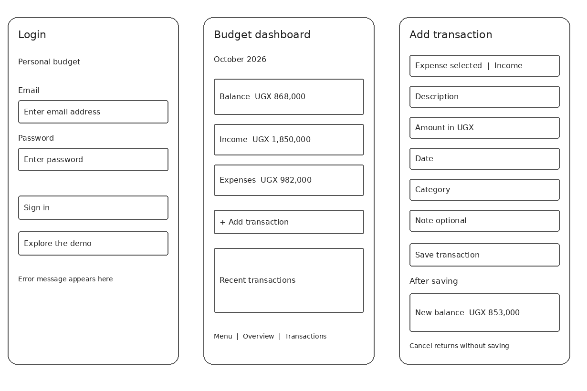
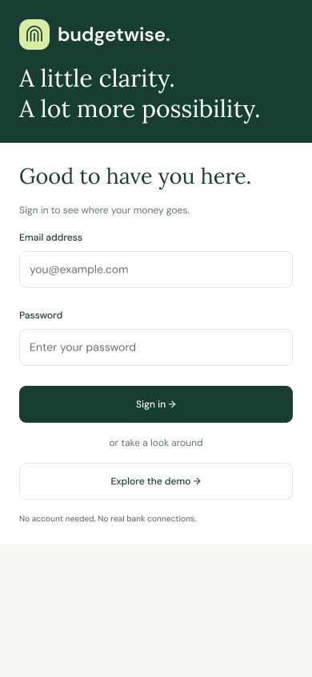

# Personal Budget Management System Report

**Project:** Budgetwise  
**Student:** Ainemukama Alfred  
**Course unit:** UI/UX Design  
**Date:** 31 October 2026

## Introduction

Budgetwise helps users record income and expenses and see the remaining monthly balance. It follows Login → Budget dashboard → Add transaction → Updated summary. The website uses HTML, CSS, JavaScript and fictional sample data.

## User research

Basic desk research reviewed the assignment, existing code, Figma screen structure and deployed website. Proposed users are students, salaried workers and people with irregular income. They need quick entries, clear amounts and visible monthly totals. These groups and likely difficulties are assumptions to check with users. No interviews or survey results were supplied. [Research details and questions](RESEARCH.md).

## Problem and requirements

Users need one simple place to record money and see what remains. Main requirements are a login interface, monthly dashboard, income/expense form, validation, updated summary, easy navigation and a layout that works on phones and computers. [Full requirements](REQUIREMENTS.md).

## Ideas and sketches

A transaction list and a dashboard were considered. The dashboard was selected because the monthly position is easier to see first. The three digital wireframes show Login, Dashboard, and Add transaction with its saved summary. They are guides for drawing the required paper sketches; they are not photographs of paper work.

## Figma design

The existing [mobile Figma file](https://www.figma.com/design/FQLOMqCsZITyL52DR6MInm) has verified Login, Overview, Add transaction and Updated summary frames at 390 × 844 pixels. It uses consistent buttons, fields and summary cards. The website uses dark green, light green, DM Sans and Lora. [Screen links and exported design](figma/README.md). [Design explanation](DESIGN.md).

## Implementation

HTML loads the page, CSS controls the layout, and JavaScript handles navigation, validation, calculations and browser storage. The form records type, description, amount, date and category. Notes are optional. Balance equals monthly income minus monthly expenses.

### Login

### Budget dashboard

### Add transaction

### Updated summary

## Checks and result

All 18 existing model tests passed. The live desktop browser check confirmed empty-form errors, demo navigation, the balance preview, saving and persistence after reload. Starting October income is 1,850,000 UGX and expenses are 982,000 UGX, leaving 868,000 UGX. Adding a 15,000 UGX expense makes expenses 997,000 UGX and balance 853,000 UGX. [Check results](QA.md).

## Limitations and conclusion

The main journey works with sample data. Login is simulated and records stay in one browser. Participant interviews, usability feedback and student paper sketch photographs are still needed where the lecturer requires those activities. The next step is to collect that feedback and demonstrate the completed interface using the [presentation guide](PRESENTATION.md).

## Project links

- [Website](https://ui-ux-ivory.vercel.app/)
- [Source repository](https://github.com/ainemukama-alfred/ui-ux)
- [Mobile Figma designs](https://www.figma.com/design/FQLOMqCsZITyL52DR6MInm)
- [Printable report](Budgetwise_Report.pdf) and [editable report](Budgetwise_Report.docx)
