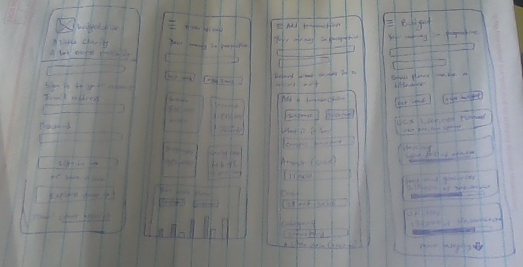

# Personal Budget Management System Report

**Project:** Budgetwise  
**Student:** Ainemukama Alfred  
**Course unit:** UI/UX Design  
**Date:** 31 October 2026

## Introduction

Budgetwise helps users record income and expenses and see the amount remaining each month. The main journey is Login → Budget dashboard → Add transaction → Updated summary. The interface is built with HTML, CSS and JavaScript.

## User research

The research focused on the tasks involved in managing a personal budget. These include recording money received, adding everyday expenses and checking the remaining balance. The intended users are students, salaried workers and people with irregular income.

The task analysis identified a need for quick entry, clear UGX amounts, monthly totals and feedback after saving. These needs are addressed through summary cards, labelled fields, an income/expense switch and an updated summary. [User research](RESEARCH.md).

## Problem and requirements

When money records are scattered, it is difficult to see how much remains. Budgetwise keeps entries together and calculates totals automatically. The main requirements are sign-in, a monthly dashboard, a transaction form, validation, an updated summary and easy navigation. [Requirements](REQUIREMENTS.md).

## Design ideas and sketches

A transaction list is useful for checking individual entries, while a dashboard makes the monthly position easier to understand. The design uses a dashboard first, with a separate Transactions page for detailed records.

The hand-drawn wireframes show the login page, dashboard, transaction form and budget page. They establish the placement of fields, summary information and main actions.

## High fidelity design

The [Figma designs](https://www.figma.com/design/FQLOMqCsZITyL52DR6MInm) show the mobile interface. The main screens are Login, Overview, Add transaction and Updated summary.

Dark green is used for the main actions and brand. A light background separates the cards from the page. DM Sans is used for body text and numbers, while Lora is used for main headings. Repeated colours, fields and buttons keep the screens consistent.

## Implementation

HTML loads the interface, CSS controls the appearance and responsive layout, and JavaScript handles navigation, form validation, calculations and browser storage.

The login accepts the configured account without displaying its details. The dashboard presents income, expenses and balance for the selected month. The transaction form records the type, description, amount, date and category, with an optional note. After saving, the summary shows the new entry and updated totals.

### Login

### Budget dashboard

### Add transaction

### Updated summary

## Testing

The mobile interface was checked for sign-in, empty fields, incorrect login details, transaction validation and saved totals. Incorrect login details show an error. An incomplete transaction is not saved. Reloading keeps the saved entries in the same browser. The layout was checked at widths of 320 and 390 pixels.

| Item | Before saving | After a 15,000 UGX expense |
| --- | --- | --- |
| Income | 1,850,000 UGX | 1,850,000 UGX |
| Expenses | 982,000 UGX | 997,000 UGX |
| Balance | 868,000 UGX | 853,000 UGX |

## Conclusion

Budgetwise provides a clear way to record income and expenses and follow a monthly budget. The hand-drawn sketches, mobile designs and working interface show the journey from sign-in to an updated summary.

## Project links

- [Repository](https://github.com/ainemukama-alfred/ui-ux)
- [Figma designs](https://www.figma.com/design/FQLOMqCsZITyL52DR6MInm)
- [PDF report](Budgetwise_Report.pdf)
