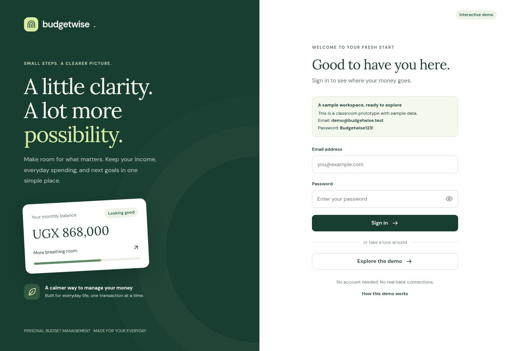
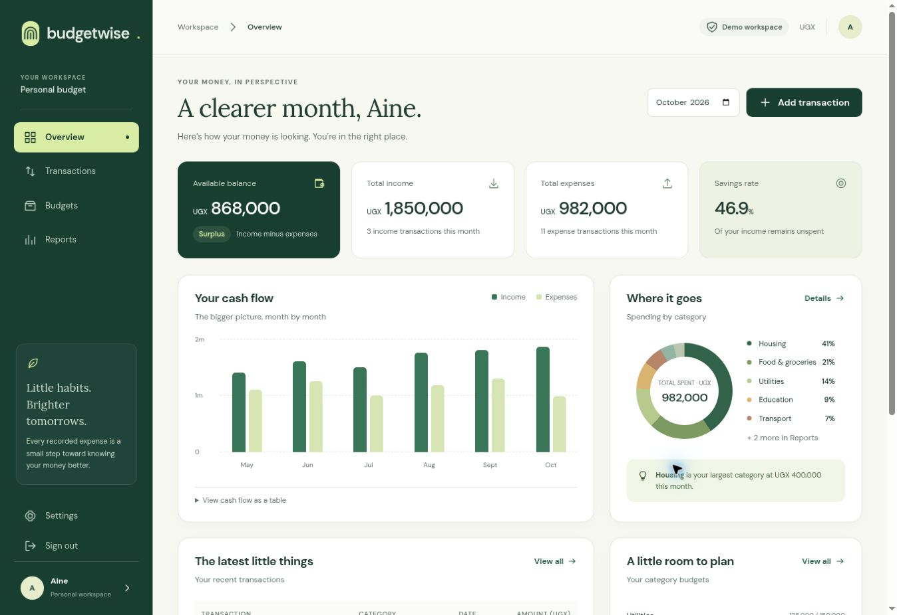
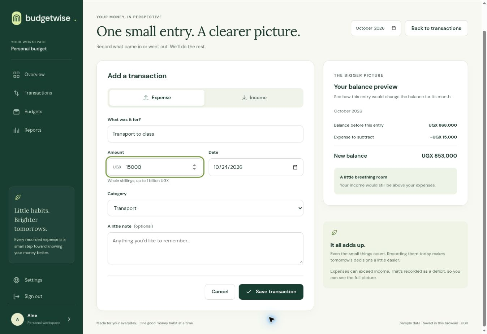
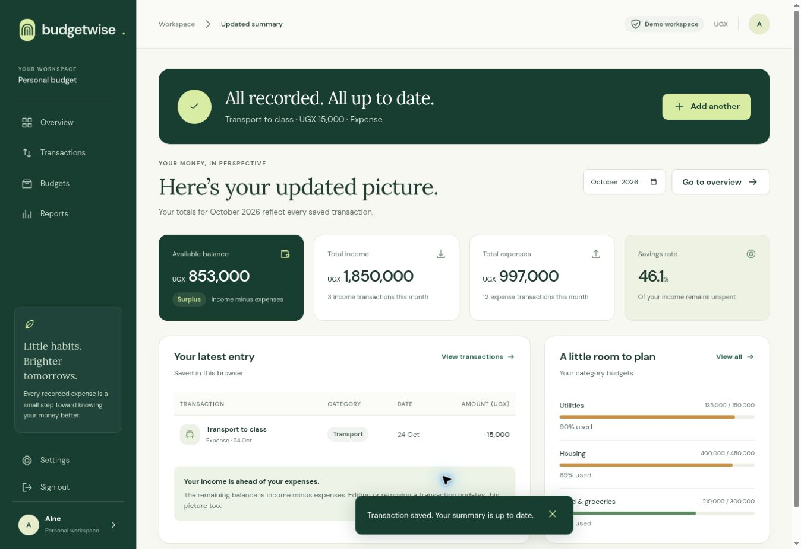

# Working website screenshots

Captured from https://ui-ux-ivory.vercel.app/ on 31 October 2026 using fictional sample records in a separate browser workspace. These are desktop implementation screenshots; the Figma designs are mobile.

## Login

## Budget dashboard

## Add transaction

## Updated summary

The dashboard starts with UGX 1,850,000 income, UGX 982,000 expenses and UGX 868,000 balance. The new expense is UGX 15,000 on 24 October 2026. After saving, expenses are UGX 997,000 and balance is UGX 853,000.
