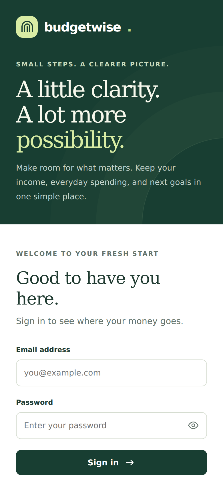
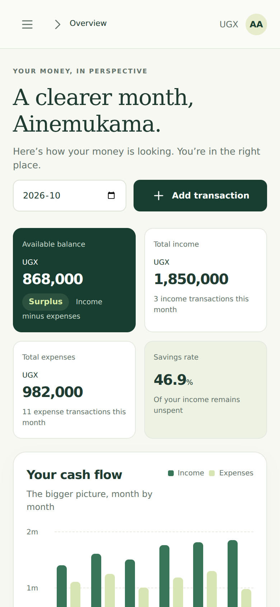
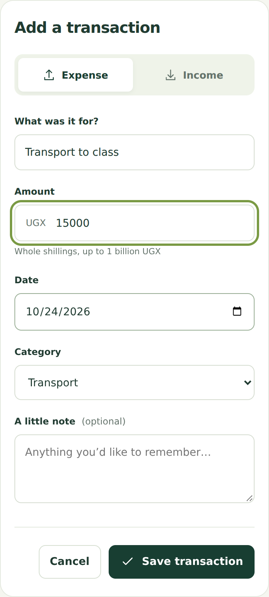
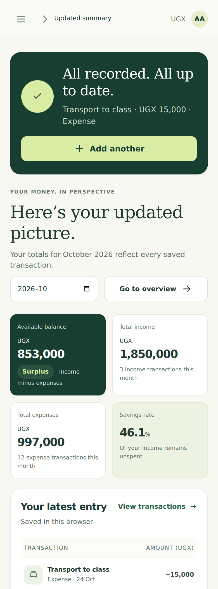
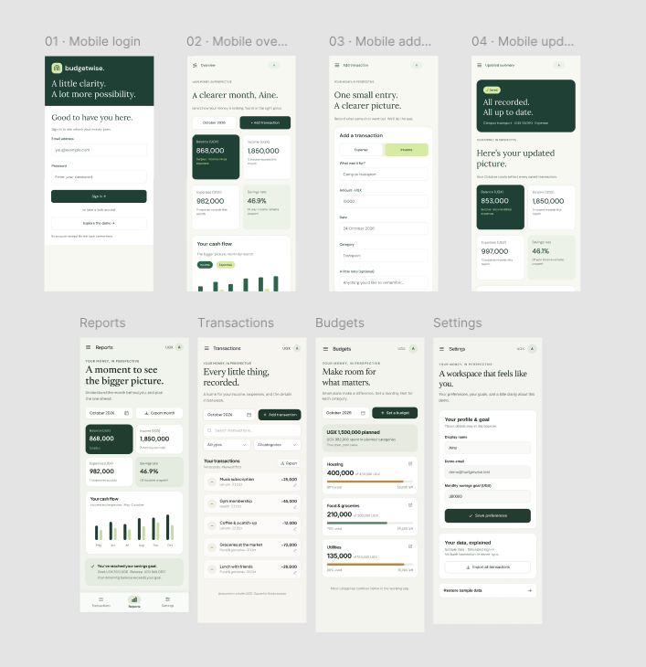

# Mobile Interface Screenshots

The screenshots show Budgetwise at a phone width of 390 pixels. Longer screens show the full page so that the form and summary details can be read.

## Login

The user enters an email address and password. Labels remain visible above the fields, and errors appear below the form.

## Budget dashboard

The dashboard shows the selected month, income, expenses and remaining balance. The Add transaction button opens the entry form.

## Add transaction

The user selects income or expense and enters the description, amount, date and category. A preview shows the effect on the balance.

## Updated summary

After a 15,000 UGX transport expense is saved, total expenses become 997,000 UGX and the balance becomes 853,000 UGX.

## High fidelity Figma designs

The Figma overview shows the eight mobile designs: Login, Overview, Add transaction, Updated summary, Reports, Transactions, Budgets and Settings.
